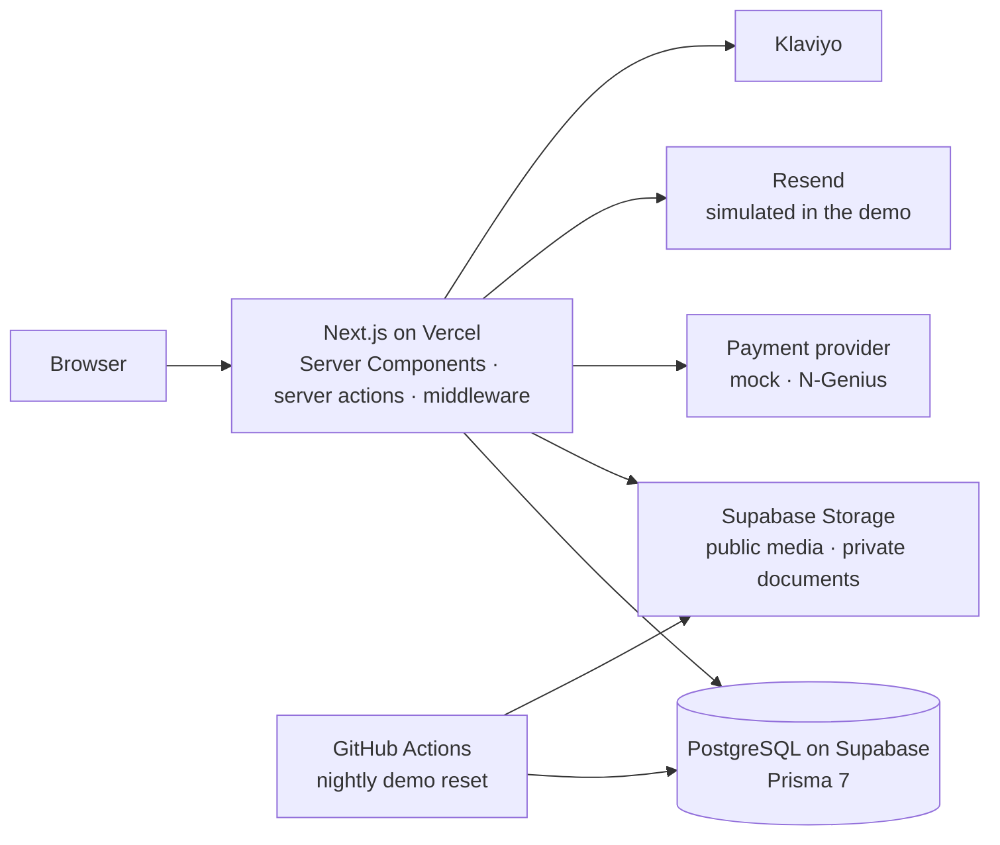

# Wildridge Hunting

A trilingual e-commerce platform for a regulated retail category, in English, Arabic (full right-to-left) and Russian. It covers the storefront, checkout and payments, order operations, B2B quotes, identity verification, support tickets, a staff-editable email system, a CMS and a role-based admin.

Wildridge is the portfolio edition of a platform I designed and built on my own for a retail client. The client edition has not launched yet. This edition runs on its own infrastructure, with a fictional brand, fictional product brands and generated demo data.

**Live demo:** https://wildridge-hunting.vercel.app
**Admin:** `/admin/login`. The sign-in pages have one-click demo accounts for a customer, a business customer and a limited staff member. Customer and staff sessions share one sign-in cookie, so open the admin in a private window.

> This is a demo. No card is charged and no email is sent. All data resets every night.

## At a glance

- 99 pages, 43 on the storefront and 56 in the admin, built with the Next.js App Router, React Server Components and server actions.
- Three languages, with the Arabic layout built on logical CSS properties rather than a mirrored stylesheet.
- 66 database tables behind Prisma 7 on PostgreSQL.
- 8 staff roles and 26 permissions, checked on the server for every admin action.
- 50 email templates, 34 for customers and 16 for staff, editable by staff in all three languages.

## Features

### Storefront and catalog
- Category navigation with a photo mega menu, and a catalog with filters (brand, caliber, price, action type, ID required), sorting, search with live suggestions and pagination.
- Product pages with specifications, accessories and quick view; a wishlist; a store locator; about, contact, FAQ with search, and policy pages.

### Cart, checkout and loyalty
- Guest and signed-in carts; shipping zones, methods and rates, including free-shipping thresholds and zones that need a shipping quote.
- Coupons, reward coupons issued automatically after qualifying orders, and a loyalty program with earn rules, point spending and a points ledger.

### Payments
- Card payments behind a provider interface: a mock provider (used in this demo) and a stubbed N-Genius provider that is not wired up yet. A failed payment can be retried.
- Offline payments recorded by staff with proof uploads; a VAT tax invoice and a printable receipt.

### Orders and operations
- An order status workflow with an event timeline; cancel, return and refund with refund records; bulk actions and export.
- Serial-number capture, a compliance record for regulated items, delivery proof, and a stock movement ledger.

### B2B and quotes
- Trade account applications with document review, expiry and renewal.
- Quote requests that staff price and the customer finalizes into an order.

### Identity and verification
- Email and password sign-in with email verification and password reset.
- Document-based identity verification with staff review and document requests.
- A national digital ID (OAuth) integration, switched off in this demo.

### Support
- Support tickets linked to orders and quotes, with a threaded event history.

### Email system
- Staff-editable templates per language with locale fallback, a pause switch and a full send log. In the demo every send is simulated and labelled in the log.

### CMS
- A homepage editor (hero, featured products, collection tiles, video band, newsletter band, showcase and story), a popup editor, site banners with a focal-point picker, a page editor and store profiles.

### Catalog import
- Excel import with a row-level error report.

### Admin
- A dashboard with KPIs and a revenue trend; customers; staff and roles; an audit log with before-and-after diffs; newsletter subscribers with Klaviyo sync.

## Architecture

## Engineering decisions

- **Permissions live on the server.** Every admin server action passes a staff permission check before it reads or writes. Hiding a button is never the guard.
- **Money, stock and status change inside database transactions.** Order placement, payments, returns and refunds, and stock adjustments write their rows inside transactions.
- **Orders keep snapshots.** Item names, prices and addresses are copied onto the order when it is placed, so later catalog edits never rewrite history.
- **Providers sit behind interfaces.** Payments and identity verification each go through a provider interface, so the demo runs on a mock provider and the client edition on real ones with the same calling code.
- **One brand layer.** Name, logo, colors and email branding come from one config file and one stylesheet, so this edition and the client edition share the same core code.
- **Demo mode is one flag.** Open signup, one-click accounts, simulated email, upload limits and blocked staff permissions all hang off `NEXT_PUBLIC_DEMO_MODE`, and every blocked action is refused on the server.
- **Media is prepared once and served small.** Source photos are resized and stripped of metadata before they enter the seed. Pages serve them through `next/image` at the size each screen needs, and videos load only when they scroll into view.
- **The database connects through pooling.** Prisma 7 runs on the `pg` driver adapter over Supabase's transaction pooler; migrations use the session pooler.

## Tech stack

Next.js 15 (App Router, Server Components, server actions) · React 19 · TypeScript · Prisma 7 · PostgreSQL and Storage on Supabase · Auth.js v5 · next-intl 4 · Zod 4 · Zustand 5 · Tailwind CSS 4 · Framer Motion · Recharts · SheetJS · Resend · Klaviyo · Vercel · GitHub Actions

## Testing

Automated tests are the next step. Until they land, every change ships after a type check, lint, a production build and a manual browser walk of the screens it touches.

## Running locally

Requirements: Node 22 (see `.nvmrc`) and a Supabase project.

1. Copy `.env.example` to `.env` and fill it in.
2. Run `supabase/storage-buckets.sql` in the Supabase SQL editor.
3. `npm ci`
4. `npm run db:migrate`
5. `npm run seed`
6. `npm run dev`, then open http://localhost:3000.

`npm run demo:reset` rebuilds the database, reseeds it and removes uploaded files. It refuses to run unless demo mode is on and every database and storage URL belongs to `DEMO_PROJECT_REF`.

## License

No license is granted. The code is shared for review only.
